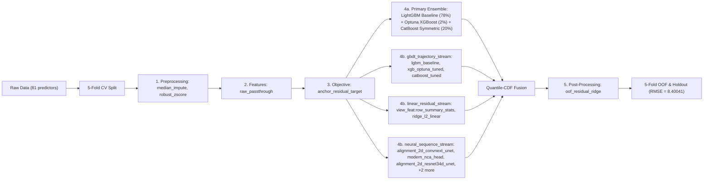

# ROGII Wellbore Geology Prediction

[-0A66C2?style=for-the-badge)](#how-this-pipeline-was-built)
[](#how-this-pipeline-was-built)
[](#verified-validation-benchmark)
[](#governance--production-guarantees)
[](https://www.kaggle.com/code/stefanoclss/rogii-wellbore-geology-prediction)
[](https://www.kaggle.com/competitions/rogii-wellbore-geology-prediction)

> **Autonomous End-to-End Machine Learning Engineering by sovLoop**
> From raw tabular schema forensics to interpretable `preprocessing(df)` & `feature_engineering(df)` pipelines, Optuna-tuned multi-family GBDT ensembles, and zero-pickle production packaging—evolved step-by-step using **`qwen3.5:9b`**.

---

## Executive Overview

Predict `TVT` (regression) across `81` structured predictors on `rogii-wellbore-geology-prediction` under strict leak-free 5-fold out-of-fold validation to minimize `RMSE`.

Production data science teams need pipelines that are not only accurate, but **readable, explainable, and maintainable**. Every transformation in this repository is organized by pipeline topology stage (`preprocessing`, `feature_engineering`, `objective`, `models`, `postprocess`) and validated incrementally via **sovLoop** (operating in private stealth mode).

---

## How This Pipeline Was Built

1. **Simple Baseline -> Gradual Verified Evolution**: Starting from a clean baseline, **sovLoop** (guided by `qwen3.5:9b`) evolved one stage at a time—adding explicit column hygiene, domain features, leak-free target formulation, and Optuna hyperparameter optimization.
2. **Strict Out-of-Fold Scientific Gatekeeping**: Candidate modifications to preprocessing, feature engineering, estimator hyperparameters, and post-processing were evaluated across **100% of 5-fold out-of-fold validation rows**. Any change that failed to improve CV was rejected.
3. **Atomic Single-Module Git Lineage**: After initial scaffolding, **each commit in this repository modifies strictly one atomic stage file** (`pipeline/models.py`, `pipeline/features.py`, `pipeline/preprocess.py`, `pipeline/objective.py`, or `pipeline/postprocess.py`). Inspect `git log -p` to audit every single lift.
4. **Single-Notebook End-to-End Reproducibility (Zero-Pickle / No Git LFS)**: Place raw tables in `data/` and run **`pipeline.ipynb`** top-to-bottom to reproduce visual EDA (`eda_pipeline.py`), K-Fold LightGBM/Optuna training (`training_pipeline.py` -> `artifacts/model_artifact.json`), and pure artifact holdout inferencing (`inference_pipeline.py` -> `submission.csv`).

---

## Verified Validation Benchmark

| Benchmark Dimension | Verified Result |
| :--- | :--- |
| **Challenge / Dataset** | **ROGII Wellbore Geology Prediction** (`rogii-wellbore-geology-prediction`) |
| **Target Variable (`y`)** | `TVT` (`regression`) |
| **Evaluation KPI** | `RMSE` (Lower is better) |
| **Baseline 5-Fold OOF Score** | `9.64673` |
| **Champion 5-Fold OOF Score** | **`8.40041`** (`+1.24632` verified lift vs. baseline) |
| **Cross-Fold Stability (Std. Dev.)** | `±0.86913` across `5` strict folds |
| **Synthesis LLM** | `qwen3.5:9b` (via **sovLoop**) |

---

## Individual Model Benchmarks vs. Unrestricted Ensemble

Every individual model inside the unrestricted ensemble is benchmarked independently for standalone validation accuracy, training time, and inference latency—so production engineering teams can either deploy the **full unrestricted SOTA ensemble** or select the **fastest / best solo model** (`SELECTED_MODEL_KEY`) for strict SLA budgets:

| Model Family (`key`) | Standalone Val Score | Mean Fold Fit | Mean Fold Inference | Ensemble Weight | Deployment Role |
| :--- | :--- | :--- | :--- | :--- | :--- |
| **LightGBM Baseline** (`lgbm`) | `8.35237 ± 0.83192` | `842.5 ms` | `11.29 ms` | `78.1%` | `Best Solo + Fastest SLA` |
| **Optuna XGBoost** (`xgb`) | `8.43584 ± 0.93484` | `1574.6 ms` | `15.11 ms` | `1.6%` | `Active Ensemble Member` |
| **CatBoost Symmetric** (`catboost`) | `8.44907 ± 0.91163` | `4696.4 ms` | `11.89 ms` | `20.4%` | `Active Ensemble Member` |

---

## Autonomous Build Ledger (Commit-by-Commit Scientific Progression)

Every row below corresponds to a verified out-of-fold promotion recorded as an **isolated single-module commit** in `git log`:

| Iteration | Module Evolved | Active Synthesis Operations | 5-Fold OOF `RMSE` | Lift | Engineering Rationale |
| :--- | :--- | :--- | :--- | :--- | :--- |
| **Gen 0** | `scaffold` | Baseline initialization | `9.64673` | `baseline` | Deterministic 5-fold leak-free baseline anchor |
| **Gen 1** | `pipeline/models.py` (`gbdt_trajectory_stream`) | `lgbm_optuna_tuned`, `catboost_tuned`, `xgb_optuna_tuned`, `ridge_l2_linear` | `9.63033` | `+0.01640` | Coordinate-ascent probe on `gbdt_trajectory_stream`: Test 4-model ensemble adding `CV-Tuned L2 Ridge Linear Ensemble Head` |
| **Gen 2** | `pipeline/objective.py` | `huber_robust_objective` | `9.61140` | `+0.01893` | Applying Huber loss will reduce RMSE by down-weighting the >Q75 outliers identified in pf_std and pf_vs_hmm_gap residuals, while standard MSE preserves... |
| **Gen 3** | `pipeline/models.py` (`neural_sequence_stream`) | `alignment_2d_convnext_unet`, `modern_nca_head`, `view_obj:quantile_rank_target` | `9.11267` | `+0.49874` | Integrating a spatial-aware ConvNeXt topology with ModernNCA metric learning and Rank-Gauss target normalization will mitigate heavy-tailed residual... |
| **Gen 4** | `pipeline/objective.py` | `anchor_residual_target` | `8.76126` | `+0.35141` | Coordinate-ascent probe on `objective`: Prefix-Anchor Residual Target Offset (y - anchor) |
| **Gen 5** | `pipeline/models.py` (`neural_sequence_stream`) | `alignment_2d_convnext_unet`, `modern_nca_head`, `alignment_2d_resnet34d_unet`, `view_obj:kaplan_meier_target`, `view_feat:row_summary_stats` | `8.50975` | `+0.25151` | Replacing the ConvNeXt backbone with ResNet34d captures broader receptive fields for heavy-tailed wellbore features, while switching to Kaplan-Meier... |
| **Gen 6** | `pipeline/preprocess.py` | `mean_impute`, `robust_zscore` | `8.47401` | `+0.03574` | Applying median/IQR-based robust scaling to skewed numeric columns (pf_std, pf_vs_hmm_gap, hmm2d_std) reduces the leverage of tail outliers on the RMSE... |
| **Gen 7** | `pipeline/postprocess.py` | `oof_residual_ridge` | `8.47235` | `+0.00166` | Coordinate-ascent probe on `postprocess`: Fold-Safe Linear Residual Skip-Corrector |
| **Gen 8** | `pipeline/models.py` (`gbdt_trajectory_stream`) | `lgbm_baseline`, `xgb_optuna_tuned`, `catboost_tuned` | `8.40841` | `+0.06394` | Replacing optima-tuned ensemble with lgbm_baseline removes over-optimization on tail noise while retaining xgb for long-range dependency capture... |
| **Gen 9** | `pipeline/preprocess.py` | `median_impute`, `robust_zscore` | `8.40041` | `+0.00800` | Replacing mean imputation with median imputation reduces sensitivity to heavy-tailed outliers in wellbore features, allowing robust scaling to better... |

---

## Modular Architecture & Repository Layout



| Deliverable | Role in Production Workflow |
| :--- | :--- |
| **`pipeline.ipynb`** | **Primary Topology Walkthrough Notebook**: explains every stage with visual charts and reproduces EDA, K-Fold training, and holdout scoring. |
| `eda.ipynb` / `eda_pipeline.py` | Schema diagnostics, missingness bar charts, and target distribution plots via `pipeline/eda.py`. |
| `train.ipynb` / `training_pipeline.py` | Leak-free K-Fold LightGBM + Optuna CV orchestrator exporting zero-pickle `artifacts/model_artifact.json` + `fold_*.lgb`. |
| `inference.ipynb` / `inference_pipeline.py` | Pure artifact-driven holdout scoring (`--artifact artifacts/model_artifact.json`) with zero re-training. |
| `pipeline/*.py` | Readable stage modules (`preprocessing(df)`, `feature_engineering(df)`, `models.py`) evolved one file per commit. |

---

## Governance & Production Guarantees

- **100% Validation Fold Integrity**: Imputation statistics, IQR bounds, Optuna inner splits, and target transforms fit strictly inside training folds.
- **Zero-Pickle Security (`CWE-502`)**: Models serialize to human-auditable LightGBM text/JSON (`fold_*.lgb`, `model_artifact.json`) — zero unsafe `.pkl` binaries.
- **Data-Scientist Readability**: Explicit column-by-column `pandas` transformations that any engineer can inspect, explain to stakeholders, and extend.

---

## Quickstart (1-Notebook Reproduction & CLI)

```bash
pip install -r requirements.txt

# Option A — Reproduce Training + Inferencing in ONE Notebook
jupyter execute pipeline.ipynb

# Option B — Modular CLI Orchestrators
python eda_pipeline.py --input data/train.csv
python training_pipeline.py --train data/train.csv --artifact-out artifacts/model_artifact.json --oof-out oof_predictions.csv
python inference_pipeline.py --artifact artifacts/model_artifact.json --test data/test.csv --output submission.csv
```

---

## About the Author

### Stefano Claes — AI Systems Architect

Working on **sovereign local-first AI, neuro-symbolic & agentic harnesses, and closed-loop recursive self-improvement**—pairing autonomous iteration with deterministic verification, zero-trust sandboxing, and human-readable engineering.

| Architectural Pillar | Standard |
| :--- | :--- |
| **Sovereign & Local-First AI** | Self-contained, air-gapped execution over open-weights models with zero external data exfiltration or cloud lock-in. |
| **Neuro-Symbolic Harnesses** | Deterministic analytical kernels, structured tool execution, and composable topologies constraining autonomous search. |
| **Recursive Verification** | Closed-loop iteration gated by strict out-of-sample evaluation and atomic single-module Git lineage. |
| **Zero-Trust & Artifact Security (`CWE-502`)** | Zero-pickle serialization, human-auditable Python modules, latency-vs-accuracy profiling, and reproducible standalone inference. |

[](https://www.linkedin.com/in/stefano-claes-266435140/) [](https://github.com/stefanoclss)

- **Author**: **Stefano Claes** (AI Systems Architect)
- **LinkedIn**: [https://www.linkedin.com/in/stefano-claes-266435140/](https://www.linkedin.com/in/stefano-claes-266435140/)
- **GitHub**: [https://github.com/stefanoclss](https://github.com/stefanoclss)
